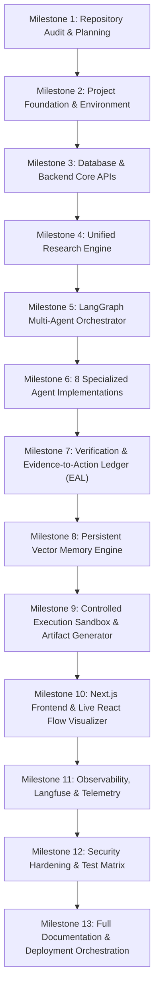

# BAN KAI Implementation Roadmap

This roadmap delineates the sequential milestone plan to engineer the complete, commercial-grade **BAN KAI: Multi-Agent AI Research & Execution Platform**.

---

## Milestone Breakdown & Acceptance Criteria

---

### Milestone 1: Repository Audit & Planning (In Progress)
- **Scope:** Audit workspace, git remote, inspect tools, evaluate open-source dependencies, publish baseline documents.
- **Key Deliverables:**
  - `REPOSITORY_AUDIT.md`
  - `docs/architecture/REPOSITORY_RESEARCH.md`
  - `docs/architecture/SYSTEM_ARCHITECTURE.md`
  - `IMPLEMENTATION_ROADMAP.md`
  - `DEVELOPMENT_STATUS.md`
- **Exit Gate:** Clean git setup, remote verified, architectural specifications accepted.

---

### Milestone 2: Project Foundation & Environment Setup
- **Scope:** Monorepo structure, Python backend packaging (`pyproject.toml` with `uv`), Next.js 15 frontend initialization, `.gitignore`, Docker definitions, and environment templates.
- **Key Deliverables:**
  - `backend/pyproject.toml` with all dependencies pinned.
  - `frontend/package.json` with Next.js 15, Tailwind, React Flow, shadcn.
  - `.env.example` comprehensive config template.
  - `.gitignore` preventing secret leakage.
- **Exit Gate:** Backend virtual environment active, frontend packages installable, base tests runnable.

---

### Milestone 3: Database & Backend Core APIs
- **Scope:** Async SQLAlchemy 2.0 models, Alembic migrations, PostgreSQL + pgvector schemas, core CRUD endpoints, FastAPI application structure.
- **Key Deliverables:**
  - Relational models: `User`, `Project`, `Task`, `AgentRun`, `ResearchSource`, `ResearchClaim`, `VerificationResult`, `Recommendation`, `ExecutionPlan`, `ExecutionAction`, `MemoryItem`, `Artifact`, `AuditLog`.
  - Alembic migration scripts.
  - REST endpoints for Projects, Tasks, and Health.
- **Exit Gate:** Database tables created, migration applies cleanly, test suite verifies CRUD operations.

---

### Milestone 4: Unified Research Engine
- **Scope:** Pluggable web search (DuckDuckGo, SearXNG, Tavily, fallback mocks), content scraping (Crawl4AI, Playwright, BeautifulSoup), source extraction, citation deduplication, and atomic claim generation.
- **Key Deliverables:**
  - `backend/app/research/engine.py`
  - `backend/app/research/search_providers.py`
  - `backend/app/research/crawler.py`
  - `backend/app/research/claim_extractor.py`
- **Exit Gate:** Queries retrieve real sources or mock fallback, claims extracted with citations, source hashes computed.

---

### Milestone 5: LangGraph Multi-Agent Orchestrator
- **Scope:** Typed shared state (`AgentState`), LangGraph `StateGraph`, conditional branching, checkpointing, pause-for-approval mechanics, timeout/recursion limits.
- **Key Deliverables:**
  - `backend/app/orchestrator/state.py`
  - `backend/app/orchestrator/graph.py`
  - `backend/app/orchestrator/nodes.py`
  - `backend/app/orchestrator/checkpointer.py`
- **Exit Gate:** State transitions deterministically through graph, state checkpointer restores session state, recursion limit enforced.

---

### Milestone 6: Specialized Multi-Agent System (All 8 Agents)
- **Scope:** Full implementation of the 8 specialized agents with typed Pydantic inputs/outputs, system prompts, error handling, and tool authorizations.
- **Key Deliverables:**
  - `backend/app/agents/orchestrator.py`
  - `backend/app/agents/research.py`
  - `backend/app/agents/market_intelligence.py`
  - `backend/app/agents/technical_research.py`
  - `backend/app/agents/data_analyst.py`
  - `backend/app/agents/verification.py`
  - `backend/app/agents/strategy.py`
  - `backend/app/agents/execution.py`
- **Exit Gate:** Each agent runs in isolation and within the shared LangGraph state with unit tests for each.

---

### Milestone 7: Verification & Evidence-to-Action Ledger (EAL)
- **Scope:** Claim verification algorithms, Research Quality Score (RQS), contradiction detection, full database-persisted EAL graph linking Objective -> Task -> Agent -> Finding -> Claim -> Source -> Verification -> Recommendation -> Plan -> Approval -> Action -> Result.
- **Key Deliverables:**
  - `backend/app/verification/evaluator.py`
  - `backend/app/eal/ledger.py`
  - `/api/v1/eal` endpoints for lineage queries and audit graph traversal.
- **Exit Gate:** RQS mathematically computed, lineage chain verified with zero orphan records.

---

### Milestone 8: Persistent Vector Memory Engine
- **Scope:** 4-tier memory architecture (Session, Project, User, Knowledge) with pgvector embeddings, cosine similarity search, deduplication thresholding, and relevance extraction.
- **Key Deliverables:**
  - `backend/app/memory/engine.py`
  - `backend/app/memory/embeddings.py`
  - `/api/v1/memory` endpoints for semantic query and CRUD.
- **Exit Gate:** Semantic search returns top-k relevant memories, duplicate memories filtered.

---

### Milestone 9: Controlled Execution Sandbox & Artifact Generator
- **Scope:** Local secure sandbox with AST security filtering, subprocess timeouts, memory limits, E2B integration adapter, file generation for Excel (.xlsx), Word (.docx), PowerPoint (.pptx), PDF, CSV, and interactive Plotly charts.
- **Key Deliverables:**
  - `backend/app/execution/sandbox.py`
  - `backend/app/execution/ast_guard.py`
  - `backend/app/execution/artifact_generators.py`
  - Human approval gate for HIGH-risk operations.
- **Exit Gate:** Dangerous code strings rejected, documents generated successfully, audit log appended.

---

### Milestone 10: Frontend & Live React Flow Visualizer
- **Scope:** Modern Next.js 15 UI with dark graphite/charcoal design system, 12 main pages, interactive React Flow live workflow graph, Evidence-to-Action Ledger viewer, Real-time SSE event consumption.
- **Key Deliverables:**
  - 12 comprehensive pages: Overview, Research Workspace, New Project, Agent Center, Live Workflow, Research Intelligence, Evidence Ledger, Execution Center, Memory Center, Analytics, Integrations, Settings.
  - Interactive React Flow workflow visualizer showing live node states.
  - Real-time SSE event bridge.
- **Exit Gate:** Frontend builds without TypeScript or styling errors, connects to backend API and SSE.

---

### Milestone 11: Observability, Langfuse & Telemetry
- **Scope:** Langfuse tracing callbacks, OpenTelemetry metrics, structured JSON logger, latency and token cost estimation.
- **Key Deliverables:**
  - `backend/app/core/telemetry.py`
  - `backend/app/core/logging.py`
  - Local fallback observability dashboard.
- **Exit Gate:** Traces logged for each agent execution, cost and duration tracked accurately.

---

### Milestone 12: Security Hardening & Full Test Matrix
- **Scope:** Prompt injection defenses, input sanitization, rate limiting, JWT auth, end-to-end integration test scenarios (business, technical, CSV analysis, contradictory evidence, approval workflow, failure recovery, memory retrieval).
- **Key Deliverables:**
  - Comprehensive unit test suite.
  - 7 End-to-End integration test scenarios.
  - AST injection and security regression tests.
- **Exit Gate:** All tests execute and pass with zero failures.

---

### Milestone 13: Full Documentation & Deployment Orchestration
- **Scope:** Complete architectural documentation, Mermaid diagrams, API references, Docker Compose production profiles, GitHub Actions CI/CD workflows, final git commit and push to `s4meer-dev/BanKai`.
- **Key Deliverables:**
  - `README.md`
  - `docs/*` specifications
  - `docker-compose.yml` & `Dockerfile`s
  - `.github/workflows/ci.yml`
- **Exit Gate:** Clean build, clean tests, pushed to GitHub remote `s4meer-dev/BanKai`.

