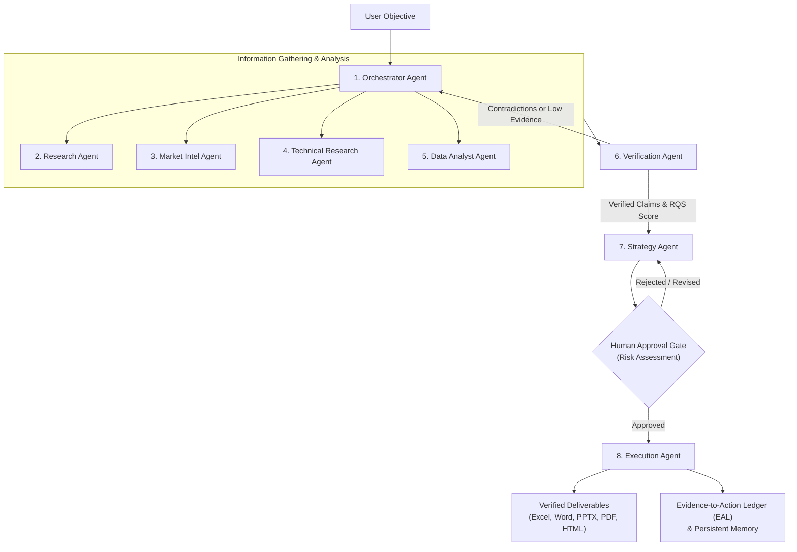

# BAN KAI

> **Autonomous Multi-Agent AI Research & Execution Platform**

BAN KAI is an enterprise-grade autonomous AI platform that transforms complex objectives into structured research, verified empirical claims, analytical insights, strategic recommendations, actionable execution plans, and approved production deliverables.

Unlike simple chatbot interfaces, BAN KAI operates as a deterministic multi-agent orchestration system with an immutable, database-persisted **Evidence-to-Action Ledger (EAL)**.

---

## Architecture Overview



---

## Key Features

1. **8 Specialized Agents:**
   - **Orchestrator Agent:** Objective decomposition, subtask scheduling, graph routing.
   - **Research Agent:** Internet search, scraping, provenance hashing, citation extraction.
   - **Market Intelligence Agent:** Competitor teardowns, CAGR sizing, SWOT analysis.
   - **Technical Research Agent:** Feasibility audits, stack comparison, architecture design.
   - **Data Analyst Agent:** Tabular analysis, financial modeling, unit economics.
   - **Verification Agent:** Adversarial fact-checking, contradiction detection, Research Quality Score (RQS).
   - **Strategy Agent:** Actionable recommendations, risk classification (`LOW`/`MEDIUM`/`HIGH`).
   - **Execution Agent:** Compiles production deliverables (Excel, Word, PPTX, PDF, HTML charts).

2. **Evidence-to-Action Ledger (EAL):**
   - Signature capability providing 100% mathematical traceability:
   - `Objective -> Task -> Agent -> Finding -> Claim -> Source -> Verification -> Recommendation -> Execution Plan -> Approval -> Execution Action -> Deliverable`.

3. **Controlled Execution Sandbox:**
   - Dual-layer security: Python AST security validator blocking dangerous system calls (`os.system`, `subprocess`, `eval`, `socket`) paired with isolated subprocess runner.
   - Human approval gate required for high-risk actions.

4. **4-Tier Persistent Vector Memory:**
   - Session, Project, Explicit User, and Knowledge memory backed by PostgreSQL and pgvector with cosine similarity deduplication.

5. **12 Main Frontend Views (Next.js 15 + React Flow):**
   - Overview Dashboard, Research Workspace, New Project, Agent Command Center, Live Workflow Visualizer, Research Intelligence, Evidence Ledger, Execution Center, Memory Center, Analytics & Telemetry, Integrations, and Platform Settings.

---

## Technology Stack

| Layer | Technologies |
| :--- | :--- |
| **Frontend** | Next.js 15, React 19, TypeScript, Tailwind CSS, React Flow (`@xyflow/react`), TanStack Query, Zustand, Lucide Icons |
| **Backend** | Python 3.12, FastAPI, Pydantic v2, SQLAlchemy 2.0 (asyncio), LangGraph 1.2, Alembic |
| **Database & Vector** | PostgreSQL 16 + pgvector, Redis, SQLite (zero-config local dev fallback) |
| **Search & Crawling** | DuckDuckGo Search, Crawl4AI, BeautifulSoup4, Playwright |
| **Data & Document Generation** | Pandas, NumPy, OpenPyXL, python-docx, python-pptx, ReportLab, Plotly |
| **Observability** | Langfuse SDK, OpenTelemetry, Structured JSON Telemetry |
| **Deployment** | Docker, Docker Compose, GitHub Actions CI/CD |

---

## Quick Start (Local Setup)

### 1. Prerequisites
- Python 3.12+
- Node.js 20+ and npm
- `uv` (recommended) or `pip`

### 2. Backend Setup
```bash
cd backend

# Create virtual environment with uv
uv venv
.\.venv\Scripts\activate   # Windows
# source .venv/bin/activate # Linux/macOS

# Install dependencies
uv pip install -r requirements.txt
uv pip install greenlet email-validator

# Run database migrations
alembic upgrade head

# Start backend server
uvicorn app.main:app --host 0.0.0.0 --port 8000 --reload
```
API Documentation is live at `http://localhost:8000/docs`.

### 3. Frontend Setup
```bash
cd frontend

# Install dependencies
npm install

# Start Next.js development server
npm run dev
```
Open `http://localhost:3000` in your web browser.

---

## Docker Deployment

To launch the complete platform (PostgreSQL + pgvector, Redis, FastAPI backend, Next.js frontend):

```bash
# Copy environment configuration
cp .env.example .env

# Build and start services
docker compose up --build -d
```

- Frontend: `http://localhost:3000`
- Backend API: `http://localhost:8000`
- Swagger UI: `http://localhost:8000/docs`

---

## Test Suite Execution

Run the complete 25-test suite covering unit tests, integration tests, API routes, and all 7 end-to-end scenarios:

```bash
cd backend
.\.venv\Scripts\python -m pytest tests/ -v
```

### Verified End-to-End Scenarios:
1. Business Market Research
2. Technical Stack Feasibility & Architecture
3. CSV Financial Modeling & Deliverable Compilation
4. Adversarial Conflicting Evidence Detection
5. Human Approval Gated Execution
6. Agent Failure & Fault-Tolerant Recovery
7. Project Vector Memory Semantic Retrieval

---

## Detailed Documentation Directory

- [System Architecture](docs/architecture/SYSTEM_ARCHITECTURE.md)
- [Agent Architecture](docs/architecture/AGENT_ARCHITECTURE.md)
- [Repository Research & Evaluation](docs/architecture/REPOSITORY_RESEARCH.md)
- [Database Schema & Migrations](docs/architecture/DATABASE_SCHEMA.md)
- [Unified Research Engine](docs/architecture/RESEARCH_ENGINE.md)
- [Persistent Memory Engine](docs/architecture/MEMORY_ENGINE.md)
- [Execution Engine & Sandbox](docs/architecture/EXECUTION_ENGINE.md)
- [Evidence-to-Action Ledger (EAL)](docs/architecture/EVIDENCE_LEDGER.md)
- [Security Model & Threat Matrix](docs/security/SECURITY_MODEL.md)
- [REST API Reference](docs/api/API_REFERENCE.md)
- [Local Setup Guide](docs/setup/LOCAL_SETUP.md)
- [Docker Setup Guide](docs/setup/DOCKER_SETUP.md)
- [Architecture Decisions (ADRs)](docs/decisions/ARCHITECTURE_DECISIONS.md)

---

## Known Limitations & Roadmap

- **Browser Automation:** Heavy JavaScript SPA crawling requires Playwright browser binaries (`playwright install`).
- **Cloud Sandboxes:** E2B micro-VM mode requires a valid `E2B_API_KEY`. In its absence, the native BanKai AST security sandbox runs locally.
- **Provider API Keys:** When commercial LLM keys are unconfigured, BanKai gracefully falls back to deterministic local mock synthesis and local Ollama inference.

---

## License

MIT License &copy; 2026 s4meer-dev. All rights reserved.

