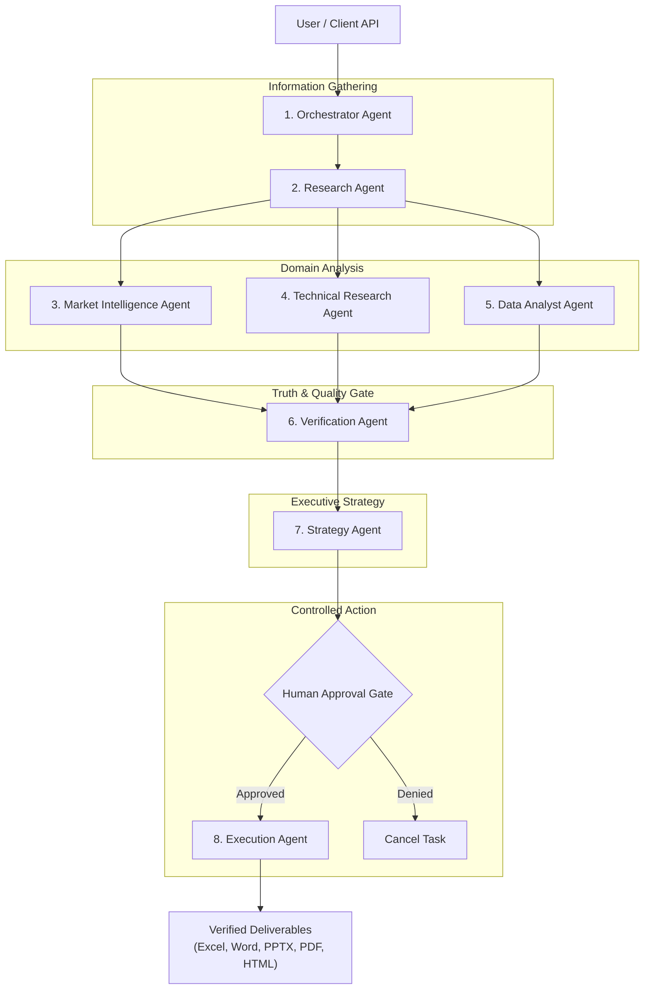

# BAN KAI Agent Architecture

BAN KAI utilizes eight specialized agents interacting via a deterministic LangGraph state machine.

---

## 1. Fleet Topology & Interaction Flow

---

## 2. Specialized Agent Specification Matrix

| Agent | Responsibility | Core Inputs | Outputs | Primary Libraries |
| :--- | :--- | :--- | :--- | :--- |
| **1. Orchestrator** | Objective decomposition, subtask scheduling, graph routing | `objective`, `domain`, `depth` | `subtasks`, `research_queries` | LangGraph, Pydantic |
| **2. Research** | Web search, crawling, content hashing, citation extraction | `research_queries` | `sources`, `claims` | Crawl4AI, BeautifulSoup, DDGS |
| **3. Market Intel** | Competitor analysis, CAGR, SWOT, market sizing | `objective`, `claims` | `market_analysis`, `swot` | Pydantic, NumPy |
| **4. Tech Research** | Feasibility audit, architecture design, stack benchmarks | `objective`, `claims` | `technical_analysis`, `stack` | Pydantic |
| **5. Data Analyst** | Tabular processing, financial models, unit economics | `objective` | `data_analysis`, `financial_model` | Pandas, NumPy |
| **6. Verification** | Fact checking, contradiction resolution, RQS calculation | `claims`, `sources` | `verification_results`, `rqs` | Heuristic / Adversarial |
| **7. Strategy** | Action roadmap, risk tiering (`LOW`/`MED`/`HIGH`) | `claims`, `rqs` | `recommendations`, `plans` | Pydantic |
| **8. Execution** | Production artifact compilation in isolated sandbox | `plans`, `data_analysis` | `artifacts`, `execution_results` | openpyxl, docx, pptx, reportlab |

