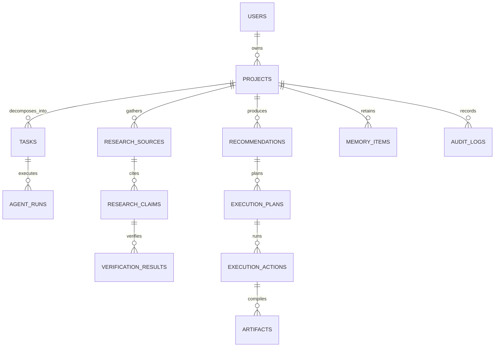

# BAN KAI Database Schema & Migration Specification

BAN KAI uses a normalized PostgreSQL 16 schema with `pgvector` extension for semantic retrieval, managed via SQLAlchemy 2.0 (asyncio) and Alembic migrations.

---

## 1. Entity-Relationship Diagram

---

## 2. Table Catalog

1. **`users`**: User accounts, hashed passwords (bcrypt), roles (`admin`, `user`), timestamps.
2. **`projects`**: Top-level workspace container, title, objective, domain settings.
3. **`tasks`**: Decomposed subtasks assigned to specialized agents with dependency arrays.
4. **`agent_runs`**: Execution telemetry per agent (latency, token usage, model name).
5. **`research_sources`**: Primary web sources with SHA-256 provenance hashes and reliability ratings.
6. **`research_claims`**: Atomic extracted factual assertions linked directly to source citations and evidence excerpts.
7. **`verification_results`**: Adversarial fact-checking records (`VERIFIED`, `PARTIALLY_VERIFIED`, `DISPUTED`).
8. **`recommendations`**: Strategic initiatives directly linked to supporting claim IDs.
9. **`execution_plans`**: Actionable tasks classified by risk level (`LOW`, `MEDIUM`, `HIGH`) and approval state.
10. **`execution_actions`**: Sandbox run records and execution audit logs.
11. **`artifacts`**: Verified deliverable files (`.xlsx`, `.docx`, `.pptx`, `.pdf`, `.html`).
12. **`memory_items`**: 4-tier persistent memory items with vector embeddings for semantic retrieval.
13. **`audit_logs`**: System security and access audit events.

