# BAN KAI Evidence-to-Action Ledger (EAL)

The **Evidence-to-Action Ledger (EAL)** is BAN KAI's signature differentiator. It mathematically guarantees that every deliverable, financial calculation, and strategic recommendation is backed by a verified, tamper-evident lineage graph.

---

## 1. Lineage Chain Traversal

```mermaid
flowchart LR
    Obj["1. Objective\n(Project)"] --> Task["2. Subtask\n(Decomposition)"]
    Task --> Agent["3. Agent Assignment\n(Orchestrator)"]
    Agent --> Source["4. Primary Source\n(SHA-256 Hashed)"]
    Source --> Claim["5. Atomic Claim\n(Evidence Excerpt)"]
    Claim --> Verif["6. Verification Result\n(Adversarial RQS)"]
    Verif --> Rec["7. Recommendation\n(Strategy Agent)"]
    Rec --> Plan["8. Execution Plan\n(Risk Tiered)"]
    Plan --> Appr["9. Human Approval\n(Governance Gate)"]
    Appr --> Action["10. Execution Action\n(AST Sandbox)"]
    Action --> Artifact["11. Verified Deliverable\n(Excel, PDF, Word)"]
```

---

## 2. Integrity Guarantees

1. **Zero Hallucinated Provenance:** No recommendation can exist in the ledger without pointing to foreign keys in `research_claims`.
2. **Immutable Content Hashing:** Web sources are hashed with SHA-256 at crawl time to prevent source drift.
3. **Traceable Rejections:** Rejected or disputed assertions are recorded with rationales rather than silently discarded.

