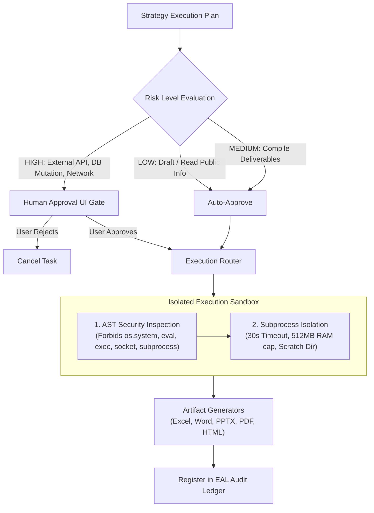

# BAN KAI Controlled Execution Engine

BAN KAI guarantees that untrusted, AI-generated code and high-risk actions never execute unsafely on the host system.

---

## 1. Execution Architecture & Risk Gating

---

## 2. Supported Deliverable Formats

1. **Excel Financial Workbooks (`.xlsx`):** Formatted headers, currency styling, formula projections via `openpyxl`.
2. **Research Dossiers (`.docx`):** Publication typography, empirical evidence citations via `python-docx`.
3. **Executive Presentations (`.pptx`):** Multi-slide corporate briefings via `python-pptx`.
4. **Publication Reports (`.pdf`):** Tables, quality metrics, and evidence tables via `reportlab`.
5. **Interactive Visualizations (`.html`):** Dynamic responsive bar and scatter plots via `plotly`.

