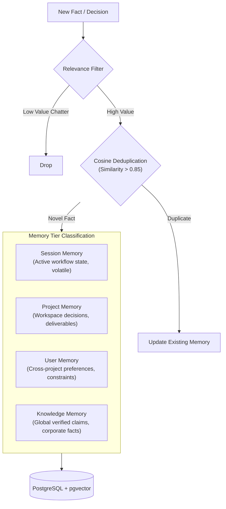

# BAN KAI Persistent Memory Engine

BAN KAI employs a 4-tier persistent memory architecture combining relational metadata and pgvector semantic retrieval.

---

## 1. Memory Tier Partitioning

---

## 2. Deduplication & Semantic Search

- **Embedding Model:** OpenAI `text-embedding-3-small` (or local deterministic vector representation fallback).
- **Metric:** Cosine distance over normalized 128-dim or 1536-dim vector arrays.
- **Deduplication Threshold:** If an incoming memory key/content matches an existing record in the same project/tier with similarity $\ge 0.85$, the existing record is updated in place to prevent database pollution.

