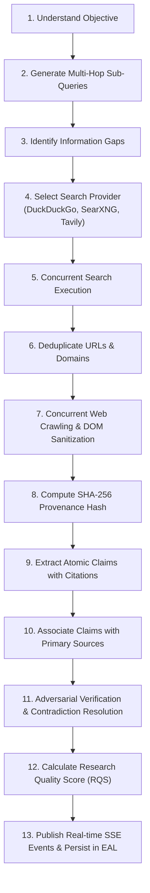

# BAN KAI Unified Research Engine

The Unified Research Engine executes an autonomous 13-step intelligence gathering lifecycle.

---

## 1. Research Lifecycle Flow

---

## 2. Research Quality Score (RQS) Methodology

The **Research Quality Score** is an empirical composite index ($0.0 \dots 100.0$) evaluated as:

$$\text{RQS} = (C \times 20.0) + (R \times 30.0) + (V \times 35.0) + (D \times 15.0)$$

Where:
- $C$: **Citation Coverage** (Ratio of claims linked directly to source URLs)
- $R$: **Mean Source Reliability** (Publisher integrity and domain reputation metrics)
- $V$: **Verification Rate** (Ratio of corroborated to unverified assertions)
- $D$: **Contradiction Resolution Rate** (Penalty for unreconciled conflicting statements)

