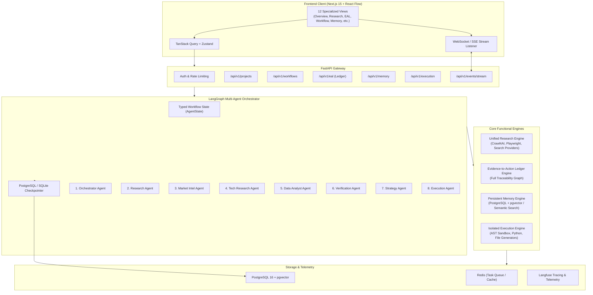
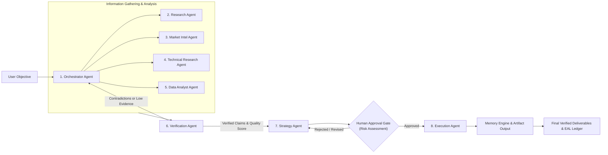
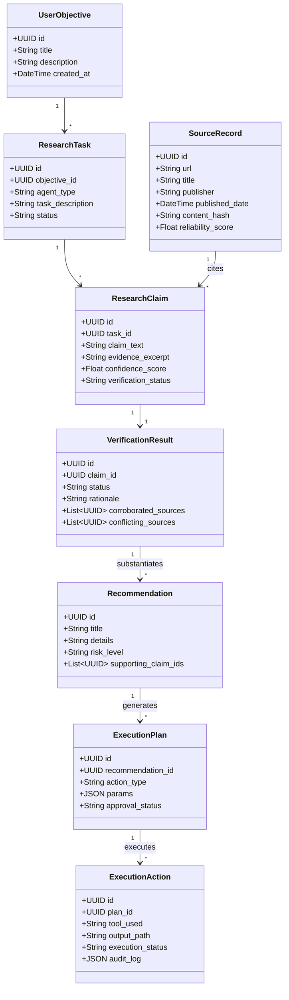
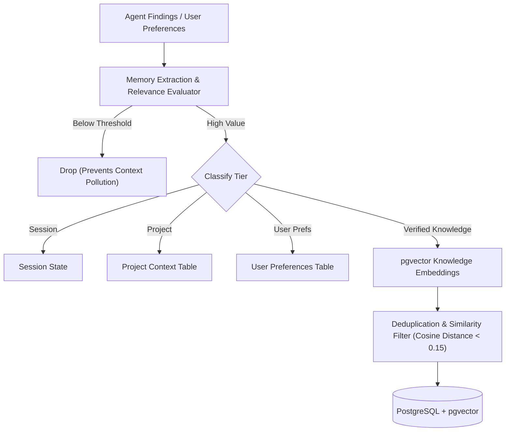
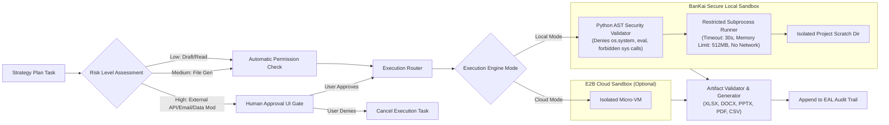
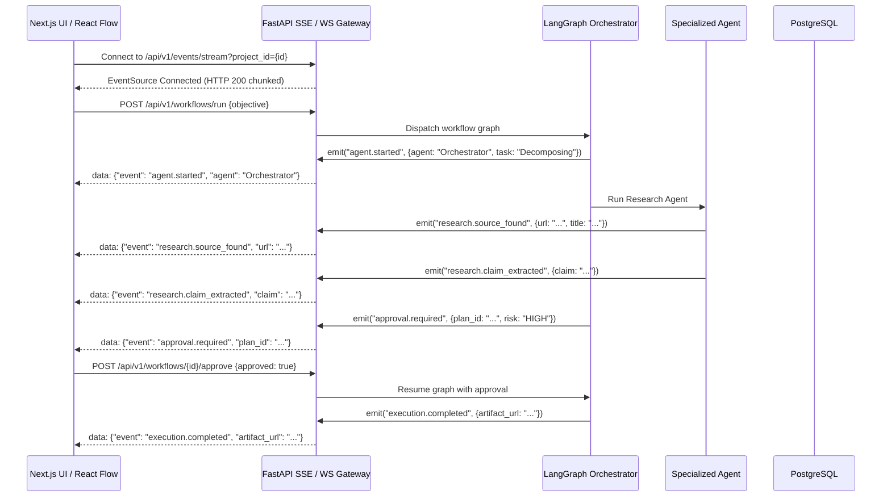

# BAN KAI System Architecture

BAN KAI is an autonomous Multi-Agent AI Research and Execution Platform designed for rigorous research, factual verification, strategic planning, and human-supervised task execution.

---

## 1. High-Level Architecture Diagram

---

## 2. The 8 Specialized Agents & Responsibilities

### Agent Detailed Specifications

1. **Orchestrator Agent:**
   - Evaluates objective scope and complexity.
   - Decomposes into structured, dependency-aware subtasks.
   - Assigns subtasks to specialized agents.
   - Monitors execution state, handles retries, and aggregates outputs.
   - Decides deterministically when research is sufficient or if recursive queries are needed.

2. **Research Agent:**
   - Executes multi-query search across web engines.
   - Extracts clean Markdown, metadata, and publication details.
   - Formulates atomic factual claims linked to precise source citations.

3. **Market Intelligence Agent:**
   - Conducts competitor teardowns, market sizing, industry trends, and SWOT analyses.
   - Identifies market opportunities and customer segments with empirical evidence.

4. **Technical Research Agent:**
   - Evaluates technical feasibility, software architectures, GitHub repositories, and API ecosystems.
   - Compares frameworks and produces benchmark-backed technical recommendations.

5. **Data Analyst Agent:**
   - Cleans, parses, and analyzes CSV, Excel, and JSON datasets.
   - Computes statistical summaries, financial modeling, and metric distributions.
   - Executes data transformations in the isolated execution sandbox.

6. **Verification Agent:**
   - Cross-references extracted claims against independent sources.
   - Flags contradictions, unsupported statements, and outdated claims.
   - Calculates the **Research Quality Score (RQS)** and assigns verified status (`VERIFIED`, `PARTIALLY_VERIFIED`, `DISPUTED`, `UNVERIFIED`, `INSUFFICIENT_EVIDENCE`).

7. **Strategy Agent:**
   - Synthesizes verified claims into strategic, actionable recommendations.
   - Produces risk assessments, resource estimates, and chronological execution roadmaps.
   - Assigns risk levels (`LOW`, `MEDIUM`, `HIGH`) to proposed actions.

8. **Execution Agent:**
   - Executes approved tasks only.
   - Generates production deliverables (Excel models, PDF summaries, Word docs, PowerPoint decks, Plotly charts).
   - Validates generated outputs against expected schemas before final delivery.

---

## 3. Evidence-to-Action Ledger (EAL)

The Evidence-to-Action Ledger is BAN KAI's signature differentiator: it guarantees mathematical and relational traceability for every output.

---

## 4. Persistent Memory Engine Architecture

The Memory Engine maintains 4 distinct memory tiers:
1. **Session Memory:** Volatile, per-workflow execution state and intermediate message log.
2. **Project Memory:** Persistent context, decisions, and goals specific to a project workspace.
3. **Explicit User Memory:** User preferences, organizational constraints, and persistent guidelines.
4. **Knowledge Memory:** Verified claims, historical research corpora, and cross-project findings stored with vector embeddings for semantic retrieval.

---

## 5. Execution Sandbox & Security Architecture

---

## 6. Real-time Event Streaming Architecture

